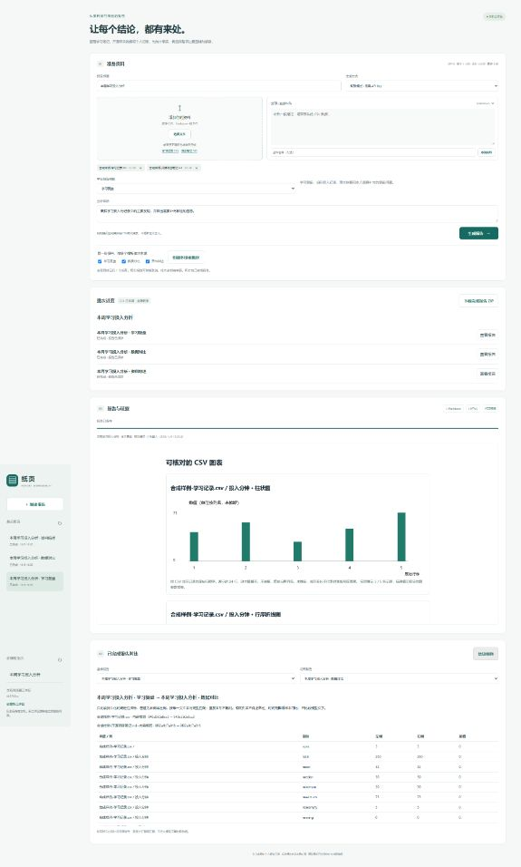
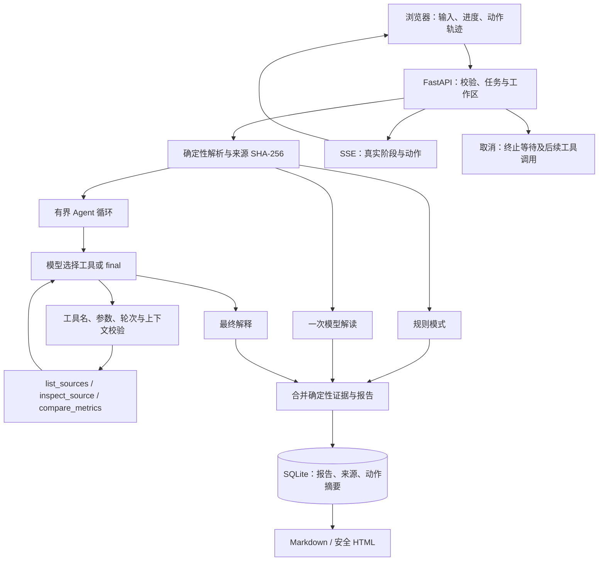

# 纸页 · Report Workbench Agent

一个有界工具调用的个人报告 Agent：输入学习笔记、开源项目数据或个人记录，由模型选择检查资料、比较真实指标，再生成附带来源的结构化报告。后端采用 FastAPI 与 SQLite，前端是无需构建的原生浏览器界面。

[](https://github.com/zhyzx35607/report-workbench-agent/actions/workflows/test.yml)



默认规则模式不需要 API Key，也不访问外网。CSV 的行数、缺失值、零值、数值合计/均值/中位数/极值与文本高频值来自实际输入。Markdown/TXT 提供字符统计、标题索引和原文摘录，明确标为**规则提要，不是全文语义摘要**。可选模型模式在确定性证据之后补充解释；接口失败会使任务失败，不生成虚构报告。

v0.2 已实现三种报告模板、确定性 CSV 图表、多模板串行批次、单任务取消、完成报告 ZIP 和已完成报告指标对比。模板实际改变目标提示与报告区块；同一份输入可以一次生成三份不同组织方式的报告。

提供三种清晰区分的模式：

| 模式 | 行为 | 需要模型 |
|---|---|---|
| 规则模式 | 确定性统计、原文摘录、来源与导出 | 否 |
| 直接模型解读 | 一次请求解读已解析证据，不声称有工具规划 | 是 |
| 报告 Agent | 模型选择工具 → 严格校验 → 执行工具 → 回传结果 → 继续或完成 | 是，接口必须支持 function tools |

Agent 不是把一次摘要请求换个名字：它有标准 `tool_calls` 协议、3 个工具白名单、严格参数校验、有限轮次、取消传播及持久化动作轨迹。没有实际检查过证据的最终回答会被拒绝。

本项目独立实现，没有复制公司框架代码、业务数据、客户品牌、内部接口、私有 npm 包或历史凭据。

## 本机启动

需要 Python 3.11 或更高版本。

Windows PowerShell：

```powershell
./start.ps1
```

macOS / Linux：

```bash
sh start.sh
```

脚本首次创建 `.venv` 并安装项目依赖，然后在 `http://127.0.0.1:8767` 启动。首次安装依赖需要网络；之后规则模式可离线运行。也可手动操作：

```bash
python -m venv .venv
# 激活虚拟环境后
python -m pip install -e '.[test]'
python -m uvicorn report_workbench.app:app --host 127.0.0.1 --port 8767
```

在页面添加 UTF-8 `.csv`、`.md` 或 `.txt` 文件，或直接粘贴内容；两个按钮提供明确标注的合成样例。生成后可以查看进度、取消任务、打开历史报告，并导出 Markdown 或可打印 HTML。打印预览打开独立报告页面，再使用浏览器打印功能保存为 PDF。

## 模板、图表与批次

| 模板 | 实际报告内容 |
|---|---|
| 学习复盘 | 本次记录概况、投入与资料证据、需要本人补充的复盘问题 |
| 数据对比 | 多份 CSV 同名数值列并排统计、逐份来源、单位和样本口径核验 |
| 资料综述 | 来源覆盖范围、资料索引与有限原文依据、资料缺口 |

只有一份 CSV 时，数据对比模板明确说明没有可配对资料，不虚构对照。每份 CSV 最多展示前 3 个数值列、前 24 条非全空记录，每列包含柱状图与行序折线图；缺失值保持缺失并断开折线，负数以零基线呈现。图表不推断日期、单位或趋势因果，报告同时提供精确数据表。浏览器预览、单份 HTML 与 ZIP 内 HTML 使用同一个 SVG 渲染函数；Markdown 导出保留数据表。

勾选 1—3 种不同模板后点击“创建多模板批次”。单份与批次任务共用全局并发为 1 的串行队列，每个工作区最多 9 个未结束任务、整个进程最多 16 个。可取消任一等待中或运行中的任务；一个任务失败不阻断后面的任务。批次全部结束且至少一份成功时，ZIP 打包已完成报告的 Markdown/HTML，并附包含所有任务状态的 `manifest.json`。没有将失败或取消任务伪装为完整报告。

页面底部可选择两份已完成报告，对比持久化的数值统计与来源哈希。按唯一文件名和类型配对，重复同名来源标为歧义；仅比较两侧都存在的数值列，差值为右侧减左侧。它不从模型文章抽取数据，也不把同名列当作单位和样本口径必然一致。

`examples/` 还提供两份用于比较的学习记录和一份项目笔记。它们都是合成数据，不来自任何实际公司或个人记录。三分钟演示流程与简历表述见 [docs/resume.md](docs/resume.md)。

## 可选模型配置

支持提供 `/chat/completions` 端点的通用接口。配置由服务端环境变量读取，不在网页保存或返回密钥。例如 PowerShell：

```powershell
$env:REPORT_MODEL_BASE_URL = 'http://127.0.0.1:1234/v1'
$env:REPORT_MODEL_NAME = 'your-local-model'
# 如接口需要认证，在当前终端设置 REPORT_MODEL_API_KEY；不要提交该值。
./start.ps1
```

| 变量 | 作用 | 默认值 |
|---|---|---|
| `REPORT_MODEL_BASE_URL` | 模型接口根路径，通常以 `/v1` 结尾 | 未设置 |
| `REPORT_MODEL_NAME` | 接口实际支持的模型标识 | 未设置 |
| `REPORT_MODEL_API_KEY` | 可选 Bearer 密钥 | 未设置 |
| `REPORT_DATA_DIR` | SQLite 数据目录 | 当前目录的 `data` |

模型模式发送分析目标、文件名/哈希、CSV 统计和文档的有限摘录；不发送没有被摘录的文档全文。模型解释与确定性证据分开展示，解释仍需人工核验。没有模型服务时，规则模式保持可用。

## Agent 工具与执行约束

| 工具 | 参数 | 实际操作 |
|---|---|---|
| `list_sources` | 无参数 | 列出本次输入的 ID、文件名、类型、字节数与哈希 |
| `inspect_source` | `source_id` | 返回对应资料的确定性统计或有限文档摘录 |
| `compare_metrics` | `source_ids`、`metric`，列指标另需 `column` | 比较同一指标并计算相对第一份资料的差值 |

比较支持 CSV 行数/列数、文档字符数/行数，以及 CSV 指定列的合计、均值、极值、非空或缺失数量。工具只操作当前任务的已解析证据，不提供任意 Python、Shell、SQL、文件路径或数据库访问。来源 ID 必须存在，额外参数、错误类型、缺失列、重复 ID、非法工具名都会使任务明确失败。

每个 Agent 任务最多 **6 轮模型请求**，每轮最多 **3 次工具调用**；工具参数最多 4096 字符、单次结果最多 24000 字符、累计模型上下文最多 120000 字符。达到上限仍未 final 时任务失败，不能把中间产物当作成功报告。最终回答之前必须至少完成一次 `inspect_source` 或 `compare_metrics`。

已经成功执行的同一工具、规范化参数和不可变证据指纹再次出现时，运行时以 `no_progress` 失败结束，防止反复获取相同证据。检查另一份来源仍是合法的新动作。

公开轨迹记录轮次、工具名称、白名单参数、状态、结果摘要、证据指纹和步骤耗时；模型调用只记录供应商实际返回的合法整数 `usage`，缺失或非法时为 `null`，不估算 token。页面可查看并导出轨迹 JSON。取消终态优先保存，因此取消时不保证仍在等待的步骤会补写耗时。

模型响应中的 `reasoning_content` 等隐藏思维字段和工具调用前的自由文本不持久化、不展示。模型最终报告作为公开输出保存。

## 能力边界

- 单个输入最多 1 MiB，最多 8 份，总计最多 4 MiB；HTTP 请求体最多 8 MiB。仅接受非空 UTF-8 文本。
- CSV 使用逗号分隔，必须有唯一且非空的表头，至少一行数据，最多 50000 行、100 列。完全空白行忽略；列数不一致会明确失败。
- 数值列要求所有非空值均可解析为有限十进制数。缺失值不参与统计；均值最多显示 4 位小数。数值绝对值超过 `1e18` 或小数精度超过 20 位时，该列按文本处理。不会推断列的单位、金额意义、比例或因果。
- 文档模式依次摘录前 5 个非标题段落，每段最多 420 字符，展示前 12 个 Markdown 标题；长文后部可能未包含在摘录中。
- 直接模型解读模式最多发送 60000 字符的证据 JSON；Agent 模式使用上述分步预算。每次模型请求超时为 90 秒，连接超时为 10 秒。
- 进度是实际处理阶段与输入完成比例，不是假装逐字生成。模型调用期间显示等待状态。取消会关闭本地等待并阻止保存报告，远端供应商可能仍完成已接收的请求。
- 报告保存最终 Markdown、来源元数据、确定性统计、图表的有限数值采样、文档有限摘录、任务/批次状态与公开轨迹；不另存上传原件。SQLite 默认位于 `data/reports.sqlite3`，旧数据库自动增列并保留历史。旧报告没有持久化 evidence 时仍能查看和导出，但不能参与新指标对比。
- 来源 SHA-256 和字节数针对实际参与分析的 UTF-8 文本计算；上传时剔除 UTF-8 BOM，因此带 BOM 文件的原始字节哈希可能不同。
- 工作区 UUID 保存在浏览器 localStorage；不同工作区的历史、导出、预览和取消操作均隔离。它是单机使用的访问标识，不是多人账户认证。创建新工作区不会删除旧数据；清除浏览器存储会失去原工作区标识。默认仅监听本机。
- 单进程运行。服务重启后，未完成任务会标记取消，不恢复队列或自动重试付费请求。取消不能强杀已进入 `asyncio.to_thread` 的解析线程，线程可能短暂继续，但不能再保存成功报告。

## 架构



核心文件：`report_workbench/agent.py` 实现工具协议与有限循环；`engine.py` 负责模板、输入、统计和模型网关；`charts.py` 从持久化证据生成 SVG 与指标对比；`store.py` 负责参数化 SQLite 存取；`app.py` 负责串行任务队列、批次、隔离、SSE、上传与导出；`static/` 包含界面。不存在公司领域的债务、财务、人事或企业风险计算。

新增接口均使用 `X-Workspace-Id`：`POST/GET /api/batches`、`GET /api/batches/{id}`、`GET /api/batches/{id}/export/zip`、`GET /api/compare?left={id}&right={id}`、`GET /api/jobs/{id}/trace`。单份任务请求增加 `template`，批次请求使用不重复的 `templates` 列表。

## 验证

```bash
python -m pip install -e '.[test]'
python -m pytest -q
node --test tests/ui-races.test.cjs
python scripts/evaluate_runtime.py
```

当前 **56 项 Python 测试通过**，覆盖输入变化驱动统计、十进制精度、三模板真实差异、SVG 负数/缺失/转义、图表与导出一致、串行排队与取消、失败隔离、持久化迁移、ZIP、报告对比与工作区隔离，以及 Agent 工具协议、参数/预算/循环限制、供应商失败、usage 和轨迹。模型测试使用 HTTP MockTransport，不访问真实供应商或消耗额度。GitHub Actions 在 Python 3.11 / 3.12 上运行测试。

采用 MIT 许可证。

另有 **13 项 JavaScript 测试通过**，覆盖历史/批次选择、工作区切换、SSE、取消、对比、批次提交与下载乱序响应。加载新报告或批次时禁用导出，避免预览和下载错配。

固定离线运行时评测为 **16/16 通过**，结果写入被 Git 忽略的 `artifacts/runtime-eval.json`。这些用例检查成功工具链、非法参数、轮次预算、取消、供应商故障、无证据最终回答、无进展重复与队列失败隔离；它是可复现的运行时/协议评测，不是模型质量评测。浏览器已验证三模板批次、真实图表、指标对比及实际 ZIP 下载；详细范围见 [验证记录](docs/verification.md)。
