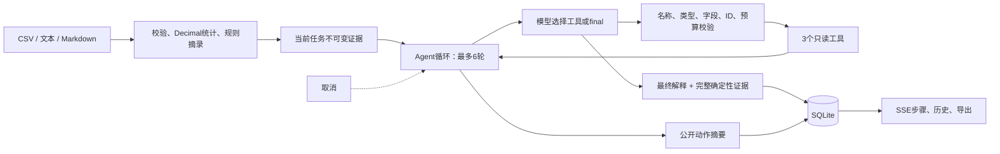

# 简历与演示说明

## 可直接使用的项目描述

**纸页报告 Agent｜Python / FastAPI / SQLite / 工具调用 / SSE**

- 独立实现面向 CSV 与 Markdown/TXT 的报告 Agent，将确定性统计、来源 SHA-256 与模型解释分层，支持规则离线运行和模型工具调用两条路径。
- 实现 `list_sources`、`inspect_source`、`compare_metrics` 三个受控工具，以严格 JSON 参数校验、6 轮模型请求和每轮 3 工具上限约束执行；拒绝任意代码/SQL、非法工具、越界来源与未经证据检查的最终回答。
- 实现学习复盘、数据对比、资料综述三模板，使用 Decimal 统计与同一 SVG 渲染器生成柱状/行序折线图，保持浏览器和 HTML 导出一致；报告对比使用持久化数值与来源哈希，不解析模型文章。
- 使用 asyncio 串行队列执行多模板批次，支持单任务取消、失败隔离、SQLite 历史与完成报告 ZIP；运行时按工具/规范化参数/证据指纹阻断无进展重复，记录公开步骤耗时与供应商实际 usage。
- 编写 **56 项 Python 测试与 13 项 JavaScript 测试**；固定离线运行时评测 **16/16 通过**，覆盖协议失败、预算、取消、无进展循环、队列隔离及异步响应归属；配置 Python 3.11/3.12 CI 测试矩阵。

这里的数字来自代码约束和本地测试结果，不代表线上用户数、生产并发、模型准确率或业务提升。项目尚未进行真实供应商横向评测；不要把协议 Mock 测试描述为真实模型效果评测。面试时根据自己实际参与和理解程度调整“独立实现”等措辞。

## 架构图

## 三分钟演示

演示前启动本机服务。Agent 路径需要配置一个实际支持 function tools 的模型接口；未配置时只演示规则模式和自动化协议测试，明确说明区别。

**0:00—0:40：生成批次。** 点击“学习记录 CSV”和“项目笔记 MD”添加合成样例，保持规则模式，点击“创建多模板批次”。三份报告依次完成，分别打开学习复盘、数据对比与资料综述，展示实际不同的区块与目标。

**0:40—1:30：核验数据。** 打开报告，展示投入分钟合计 260、均值 52、中位数 50，以及对应柱状图、行序折线图和精确值表。选择同一批次的两份报告对比，来源哈希相同、差值为 0。需要展示非零差值时，用相同文件名粘贴修改后的 CSV 另生成一份；对比按文件名与类型匹配。

**1:30—2:10：交付报告。** 下载完成报告 ZIP，打开其中的 Markdown、HTML 与 `manifest.json`，说明只打包成功报告，取消和失败状态仍在清单中。展示单份导出、批次历史与工作区隔离。

**2:10—3:00：运行时与边界。** 运行 `python scripts/evaluate_runtime.py`，说明这是 16 个固定协议/故障场景，不是模型准确率。若已有真实 function-tools 接口，可另演示 Agent 的工具选择、公开参数/耗时、取消及 JSON 轨迹；未配置则展示测试中的真实工具返回，不假装已做供应商验收。

## 面试可讲的设计权衡

**为什么不让模型直接读 CSV 并计算？** 模型负责选择下一步和解释证据；行数、均值、合计和比较差值由 Decimal 与确定性函数计算。工具输出可以独立测试，最终报告把模型解释与统计分开，便于核验。

**与一次摘要 API 有什么不同？** Agent 的下一步由模型返回的标准工具调用决定。运行时校验调用、执行工具、把结果回传，直到模型 final 或预算耗尽；三种模式在 UI 和报告中明确区分。四轮协议测试会验证真实工具返回 90、150 和差值 60，再接受最终报告。

**为什么不用任意 Python/SQL 工具？** 这个场景只需要检查与比较已解析证据。有限工具覆盖目标，同时让参数、运行量和可访问数据边界可以穷举测试。增加能力时需要新增工具 schema、实现、预算和测试，而不是开放通用执行权限。

**怎样应对模型幻觉与资料中的恶意指令？** 工具白名单和严格参数校验由代码执行，资料始终作为数据。至少检查一次真实证据才允许 final；确定性证据保留来源与哈希。模型最终解释仍可能出错，本项目不声称解决了语义层面的幻觉或提示注入问题。

**为什么保存公开轨迹而不保存完整模型上下文？** 界面需要“检查了哪个输入、比较了什么、结果是什么”，因此保存白名单参数、摘要、耗时、证据指纹和供应商实际 usage。隐藏思维字段和自由文本工具前言不会进入 SQLite/导出；持久化统计和有限原文摘录用于报告核验。缺失 usage 是 `null`，不会编造计费或 token 数。

**取消如何传播？** API 取消 asyncio 任务，在模型 await 和工具前后让出点传播 CancelledError，并把任务写成不可再覆盖的 cancelled 终态。远端服务可能仍处理已接收的请求，所以不承诺撤销供应商计费。对模型和工具两个阶段分别测试。

**为什么 SQLite 与单进程？** 目标是能本机演示和使用的个人项目，减少部署依赖。任务对象留在进程内，状态持久化在 SQLite；重启把运行中任务标记取消。若要扩展多人部署，需要新增真实账户认证、任务队列、多进程锁/租约、速率与成本配额；当前版本没有假装具备这些能力。

**56 项 Python、13 项 JavaScript 与 16 项评测是什么关系？** 16 项评测是完整 Python 测试集中固定挑选的协议/故障用例，并非额外 16 项互不重复测试。它们能证明已覆盖路径的处理、统计、隔离、失败和取消行为；不能证明任意真实模型会正确调用工具，也不能替代线上可用性或性能压测。HTTP MockTransport 隔离供应商，使工程验证不依赖账号和随机模型结果。
