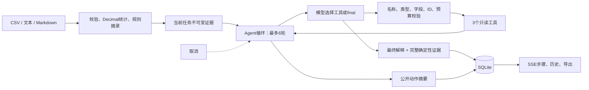

# 简历与演示说明

## 可直接使用的项目描述

**纸页报告 Agent｜Python / FastAPI / SQLite / 工具调用 / SSE**

- 独立实现面向 CSV 与 Markdown/TXT 的报告 Agent，将确定性统计、来源 SHA-256 与模型解释分层，支持规则离线运行和模型工具调用两条路径。
- 实现 `list_sources`、`inspect_source`、`compare_metrics` 三个受控工具，以严格 JSON 参数校验、6 轮模型请求和每轮 3 工具上限约束执行；拒绝任意代码/SQL、非法工具、越界来源与未经证据检查的最终回答。
- 使用 asyncio 管理任务生命周期，基于 SSE 展示真实阶段与工具结果摘要；实现模型/工具阶段取消、失败终态、SQLite 历史隔离和 Markdown/HTML 导出，不保存模型隐藏思维。
- 编写 **42 项 Python 测试与 8 项 JavaScript 竞态测试**，包含四轮成功工具链、数据变化驱动真实统计、错误参数/协议/上限、模型失败、取消、历史隔离、输出安全和异步响应归属；配置 Python 3.11/3.12 CI 测试矩阵。

这里的数字来自代码约束和本地测试结果，不代表线上用户数、生产并发、模型准确率或业务提升。项目尚未进行真实供应商横向评测；不要把协议 Mock 测试描述为真实模型效果评测。面试时根据自己实际参与和理解程度调整“独立实现”等措辞。

## 架构图

## 三分钟演示

演示前启动本机服务。Agent 路径需要配置一个实际支持 function tools 的模型接口；未配置时只演示规则模式和自动化协议测试，明确说明区别。

**0:00—0:40：说明输入与证据。** 上传 `examples/study_week1.csv` 和 `examples/study_week2.csv`。在规则模式生成报告，展示第一份 minutes 合计 90、第二份 150，以及对应哈希和来源文件。将第二份的 90 修改为 100 后重新提交，合计会变为 160；这一步说明统计真实依赖输入。

**0:40—1:40：展示工具闭环。** 选择“报告 Agent”，输入目标：“先列出资料，检查两份 CSV，再比较 minutes 合计。引用文件名，说明差值与比较局限。”在执行步骤中展示模型轮次、工具选择、实际返回结果及最终报告。具体工具次序由模型决定，程序只约束合法性和预算。

**1:40—2:20：展示可控性。** 解释模型不能请求任意 SQL 或文件路径，打开 `tests/test_agent.py` 的非法工具/参数及轮次上限测试；模型请求等待期间可点击取消，取消后无法导出一份假完成报告。真实接口响应过快时，用测试验证取消而不伪造等待动画。

**2:20—3:00：展示交付与工程边界。** 打开历史报告、下载 Markdown/HTML，说明历史按浏览器工作区访问标识隔离，当前是单机单进程设计。执行 `python -m pytest -q`，展示实际测试结果。结束时强调没有以“联网”“多 Agent”等词包装未实现能力。

## 面试可讲的设计权衡

**为什么不让模型直接读 CSV 并计算？** 模型负责选择下一步和解释证据；行数、均值、合计和比较差值由 Decimal 与确定性函数计算。工具输出可以独立测试，最终报告把模型解释与统计分开，便于核验。

**与一次摘要 API 有什么不同？** Agent 的下一步由模型返回的标准工具调用决定。运行时校验调用、执行工具、把结果回传，直到模型 final 或预算耗尽；三种模式在 UI 和报告中明确区分。四轮协议测试会验证真实工具返回 90、150 和差值 60，再接受最终报告。

**为什么不用任意 Python/SQL 工具？** 这个场景只需要检查与比较已解析证据。有限工具覆盖目标，同时让参数、运行量和可访问数据边界可以穷举测试。增加能力时需要新增工具 schema、实现、预算和测试，而不是开放通用执行权限。

**怎样应对模型幻觉与资料中的恶意指令？** 工具白名单和严格参数校验由代码执行，资料始终作为数据。至少检查一次真实证据才允许 final；确定性证据保留来源与哈希。模型最终解释仍可能出错，本项目不声称解决了语义层面的幻觉或提示注入问题。

**为什么保存动作摘要而不保存完整模型上下文？** 界面只需要“检查了哪个输入、比较了什么、结果是什么”。隐藏思维字段和自由文本工具前言不会进入 SQLite/导出；报告自身保留公开结论和原文摘录。这样减小持久化范围，也避免把调试需求变成保存所有输入与模型内部输出。

**取消如何传播？** API 取消 asyncio 任务，在模型 await 和工具前后让出点传播 CancelledError，并把任务写成不可再覆盖的 cancelled 终态。远端服务可能仍处理已接收的请求，所以不承诺撤销供应商计费。对模型和工具两个阶段分别测试。

**为什么 SQLite 与单进程？** 目标是能本机演示和使用的个人项目，减少部署依赖。任务对象留在进程内，状态持久化在 SQLite；重启把运行中任务标记取消。若要扩展多人部署，需要新增真实账户认证、任务队列、多进程锁/租约、速率与成本配额；当前版本没有假装具备这些能力。

**42 项测试能证明什么？** 能证明已覆盖路径的协议处理、统计、隔离、失败和取消行为；不能证明任意真实模型会正确调用工具，也不能替代线上可用性或性能压测。HTTP MockTransport 隔离供应商，使工程测试不依赖账号和随机模型结果。
